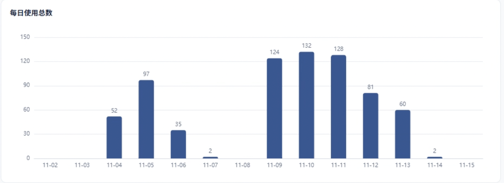

> 这是一个内部 AI 工具项目的案例分享。人名、公司、业务场景都做了脱敏，留下的数字只有硬件规格和调用规模——因为案例里的每个判断，恰恰都要靠这几个数字才能看清楚。

先把结论放在前面：这个案例里没有天灾，每一步都是可以选别的走法的。技术判断浮于表面、demo 边界没人管、项目按惯例派给了不合适的人，三层问题叠了三个月，最后一起炸在一场会上。拆开讲。标题就是本文的论点：**把这个项目逐项拆开看，卡住它的没有一处是 AI 问题**——并发管理是后端工程，容量估算是系统设计，demo 边界是项目管理，派活惯例是组织问题。

## 一、案例背景与经过

背景是一个对保密性要求很高的文档提取场景，只能本地部署。团队用两块 4090 跑一个 26B 的开源模型做提取，7 月份以 demo 形式交付验证，效果基本满足需求。

问题出在之后的三个月。用户从一个小组扩大到各分支机构，日处理量到了百件级别，而系统实测峰值并发只有个位数——两个人同时用就开始排队、变慢、报错。业务方在群里反映了一个多月，10 月初明确提出要评估设备扩容，得到的答复是暂时没有时间评估。到 11 月开会对质，双方对项目状态的认知差距才暴露出来：开发认为这只是一个待立项的 demo，从没承诺过多人可用；业务认为这是一个已经上线、已经在支撑日常工作的系统。

会上还有几个细节值得记录。开发对并发问题的第一反应是引入缓存和限流组件、搭建完整的排队机制，排期以周计；对扩容评估的第一反应是立项流程——项目尚未正式立项，此前只能算应急支持；而业务负责人当天就给出了人工调度方案：把大任务按时间段错开，两个人并行用，够用。

## 二、案例里的五个关键节点

把三个月的时间线拆开，每个节点都有更便宜的走法。

### 1、"慢"直接归因到设备

系统一变慢，结论就是设备性能不足，出路就剩两条：采购扩容，或者签保密协议上云。这两条路一个要钱、一个要周期，恰好都是最贵的。但从没人回头问一句：慢的到底是什么——是模型推理慢，是多人抢同一块卡，还是任务根本没人排队？

### 2、没人算过一笔容量账

把业务方给的几个数放在一起看，结论其实早就有了：

| 关键数字 | 规模 | 来源 |
| --- | --- | --- |
| 日处理量 | 百件级别 | 业务方给出 |
| 峰值并发 | 个位数 | 实测 |
| 单件提取耗时 | 分钟级 | 模型推理 |
| 设备 | 两块 4090 + 26B 本地模型 | 固定资产 |

按日百件、单件分钟级计算，两块卡的日产能远大于日处理量。缺的从来不是算力，只是一个把瞬时请求排队的机制。这笔账小学算术就够，但三个月里没有人算过。

### 3、最关键的需求没问出口

会上业务负责人明确表示，这个场景本质是批处理：提交一批文件后等待一段时间完全可以接受，等待期间可以去做别的事。这句话一出，整个问题就变性质了——这是纯批处理场景，不需要实时交互，一个读目录、按顺序批量处理的队列就能解决，连 Redis 都未必需要。

需求侧最关键的一条信息，是"用户能不能等"。三个月里没有人问过。没问这一句，所有人就只能在"买设备"和"上云"两条贵路里打转。

### 4、方案报成最重的那个

被问到怎么解决排队，第一反应是引入缓存、限流和完整的队列服务，排期以周计。事后接手看代码，实际需要的只是一个目录扫描加任务状态表，一两天能落地。

这里有一条值得写进团队规范的经验：**对某类问题没有实战经验的人，报出的工期永远是最保守的那个**，因为他评估的不是"这个问题多难"，而是"我最坏情况能不能兜住"。不懂并发不可怕，可怕的是不知道这类问题存在轻量解法，只能套用听过的最重方案。

### 5、被要求评估时选择了回避

10 月初业务方要求评估扩容，得到的答复是暂时没有时间评估。做一次扩容评估需要几天？大概率不超过三天。拒绝评估省下了三天，付出的是业务方对 IT 判断力的信任——从这一刻起，后面所有解释在业务方耳中都是借口。会上业务方的激烈态度，火药就是那时候埋下的。

## 三、案例背后的三层问题

五个节点串起来看，指向三个更深层的问题。

### 1、经验错位：应用层经验被当成了工程经验

这位同事确实做过多个 AI 项目，但那些项目的"AI 经验"本质上是调 API、拼提示词、做交互页面——AI 是产品里的一个功能点。而这个案例暴露的所有问题，没有一个是 AI 问题：并发管理是后端工程，容量估算是系统设计，用户量调研是需求分析，demo 边界是项目管理。

AI 项目的难点七成在传统软件工程，三成才在模型。他的经验结构正好相反——只有那三成，缺的恰恰是七成。"做过多个 AI 项目"这个标签，掩盖了经验结构的错位。

### 2、边界错位：demo 的保质期没人管理

demo 交付时，开发心里的剧本是先验证可行性、再正式立项、再采购设备变正式项目。业务的剧本是工具能用就先用起来，人多就往里拉人。两个剧本没有任何机制对齐：用户量扩大那天没人拉警报，说清楚这只是 demo、并发上限个位数、随时会坏、需要立项；也没人定期检查 demo 被用到了什么程度。三个月里，"没立项"既是开发的挡箭牌，也是双方共同的盲区。

demo 和正式系统之间应该有一条明确的管理边界：demo 交付时约定用途和上限，超限使用必须触发升级流程。这条边界谁该守？开发的直接上级、业务方的对接人、立项流程本身，都有份。事后追责一个人的沟通失误，解决不了下一次。

### 3、角色错位：项目按惯例派活，而不是按技能派活

为什么一个前端工程师会独自承担一个涉及并发、队列、算力调度的项目？因为组织里有一条惯例：无需服务端支持、无状态的工具类应用，一直交给他。这条惯例在过去的场景里是合理的，但 AI 应用项目的重心天然在后端——排队、调度、可靠性、容量，全是系统工程问题。

组织按惯性派活，让最没有系统工程能力的人独自面对最需要系统工程能力的场景，然后期待他做出正确判断。这不合理。前面五个节点里的问题，有一半在这层就注定了。

## 四、一个反差和两条规矩

案例讲到最后，最讽刺的一点浮出来：这是一个 AI 项目，但参与开发的人从头到尾没用 AI 帮自己解决问题。评估工作量靠拍脑袋报出以周计的工期，遇到不会的并发问题第一反应是找服务端支持、按排期推进，而不是先让 AI 分析代码结构和瓶颈。后来接手的人用 AI 编程助手做了完整的代码分析、结构重构和方案验证，时间以天计。

**会用 AI 的产品，不等于会用 AI 工作的人。** 到 2026 年，"我不会后端"已经不再是不可逾越的墙——墙是自己不往 AI 方向看，砌出来的。

这个案例沉淀两条规矩，后续 AI 项目直接执行：

1）**立项先问四个数**：用户数、峰值并发、单件耗时、日调用量。这四个数一出，买设备还是做排队，根本不需要开会争论，算术会给出答案。

2）**两周以上的排期，先跑一遍 AI 验证再报数**：任何超过两周的评估，先做一次 AI 辅助的代码分析和方案对比，确认最重的方案确实是最必要的方案，再报工期。不懂的领域靠记忆和听过的方案报数，在 AI 编程时代已经构成一种工作失职。

## 五、真实用量：峰值一天一百多次

看这张图，就知道这场风波有多不成比例。这是 11 月 2 日到 15 日的每日调用总数，峰值 132 次，多数日子几十到一百多次，还有两天几乎为零。

按这个量算一笔账：一天一百多次提取，单次分钟级，全部串行跑完也就大半天，两块卡有一半时间闲在那里。而它实际换来的是：排队、扩容申请、上云评估、立项流程，以及两个部门在会上的正面对质。

**技术判断造成的损失，往往和问题的物理规模无关，和判断出错的环节层级成正比。** 一句"用户能不能等"没问出口，就被放大成三个月的任务积压和一场跨部门会议——这才是这个案例里最值得记住的地方。

## 延伸阅读（本站）

- [企业 AI 落地：企业上下文、内部 FDE 与场景闸门](/post/enterprise-ai-landing/)
- [AI 原生研发：产物链、门禁与度量](/post/ai-native-sdlc-gates/)
